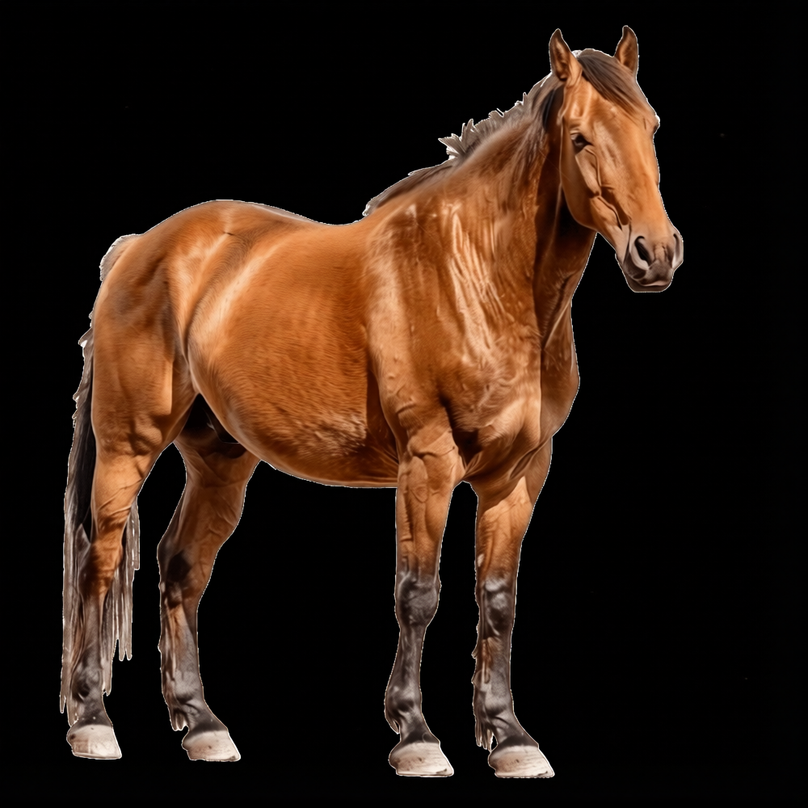

# Sparkle Bitch ✨

✨🌟💫 **Convert** 🖼️🐴🥱 ➡️➡️✨ **to** ✨➡️➡️ 🪄 🌟👀💖💫✨🤯🎆

A personal **Y2K glitter engine**, a from-scratch clone of the early-2000s
[Glitterboo](https://glitterboo.com) / Glitterfy / Picasion glitter tools. Two
modes:

- **Image / GIF:** drop in a picture or GIF; it finds the bright/high-contrast
  spots, drops in animated sparkle sprites that match the local colour and size,
  and (optionally) lays animated glitter over the photo.
- **Text:** type words (multi-line, with left/center/right align + line-spacing)
  and get **animated glitter text** — letterforms filled with shimmering "dry
  glitter" in 40 styles (rainbow, confetti, all-neon, unicorn, galaxy, fire, a
  proper **red / black / yellow**, black-&-gold, oil-slick… plus
  light-background and all-pink/all-blue/all-purple/all-green monochrome sets),
  on a transparent background so you can paste it anywhere. Or **fill the letters
  with your own uploaded image or GIF** — and an animated GIF's frame count
  becomes the text's frame count (a 16-frame GIF → 16-frame text). Then pile on
  reflective **finishes** — Holographic Menace, Oil-Slick, Liquid Chrome,
  Dichroic Glass, CD-R Rainbow, Rhinestone Overdose, Lisa Frank Plasma, Opal
  Fire, Sequins, Mother-of-Pearl, Soap Bubble, Wet Alien Jelly — and **stack
  them** (Liquid Chrome + CD Diffraction + Holographic = a hostile reflective
  life-form). Set line-spacing AND letter-spacing, flip on ALL CAPS, and add
  **stackable outlines** — each its own solid colour, its own glitter (with its
  own grain / density / strength, independent of the fill), its own uploaded
  image/GIF, or its own reflective finish.

Everything exports as a **PNG**, **animated GIF**, or **video**.

The app is built with TypeScript, Preact, and Vite. Image processing and exports
run locally in the browser; no image uploads, accounts, or runtime services are
needed. It works on a Chromebook and can work offline once loaded.

---

## Use it

**Locally:** install dependencies with `npm ci`, then run `npm run dev` and open
the URL Vite prints. To create a production build, run `npm run build`.

**Online / on your phone:** publish to GitHub Pages (see below) and open the URL.

Then:

1. **Open** an image or GIF (drag-and-drop, or click). Videos work too — see
   *Video* below.
2. Pick a look — **Classic Y2K** or **Astral Trash** — and hit **✨ Sparkle it**.
3. Nudge the sliders until it's right.
4. **Save** it as PNG, GIF, or Video. On a phone, long-press the result to save.

### Controls

| Control | What it does |
|---|---|
| **Intensity** | Overall strength / brightness of the sparkles |
| **Max size** | How big the biggest sparkles get (down to 4px for a fine dusting) |
| **Density** | How many sparkles (finer detection grid) |
| **Glow** | Size and strength of the halo behind each sparkle |
| **Color boost** | Saturation of the sparkle colour |
| **Speed** | How fast they twinkle (whole cycles per loop, so GIFs stay seamless) |
| **Shapes** | Stars / sparkles / hearts / icons / mixed |
| **Colors** | From photo (inherit local colour) · Palette · White |
| **Grain size** | (glitter styles) flake size — down to 0.2× for extra-fine glitter dust |
| **Per-outline glitter** | Each glitter **outline** has its own density / grain / strength sliders, independent of the fill (what works for the fill rarely works for a thin outline) |
| **＋ Upload image/GIF fill** | Use your own picture or GIF as the letter (or outline) fill; an animated GIF's frames set the text's animation length |
| **💅 Finishes** | Stack reflective/iridescent effects on the letters — holographic, oil-slick, liquid chrome, dichroic, CD-R rainbow, rhinestones, plasma, opal, sequins, pearl, soap, jelly — reorder and blend them by opacity |

**Advanced** (tucked away) adds Glitterboo-style placement tools:

- **Auto** — sparkle the whole image's bright areas (default).
- **Brush** — only sparkle where you paint.
- **Pen** — force sparkles anywhere, even dark/blank areas (white if there's no
  colour to sample).

…plus brightness/contrast thresholds, hue shimmer, spin, and a re-roll dice.

---

## How it works

The pipeline follows the documented Glitterboo behaviour:

1. **Analyze** (`src/engine/analyze.ts`) — compute luminance + Sobel contrast on a
   downscaled buffer, then pick well-spaced local maxima as sparkle centres,
   sampling each one's local colour and bright-region size.
2. **Instances** (`src/engine/sparkles.ts`) — each centre becomes a sparkle with a
   position, colour, size, shape and animation phase. Sprites are drawn
   procedurally and cached.
3. **Render** (`src/engine/render.ts`) — draw the base, then an additive sparkle layer
   (screen/lighter blend) with a soft glow, optional hue-shimmer, and twinkle.
   Every animated value is a function of loop phase, so exports loop cleanly.
4. **Export** (`src/engine/export.ts`, `src/engine/gif-encode.ts`) — PNG via canvas, animated
   GIF via a self-contained GIF89a encoder (median-cut palette + LZW +
   transparency frame-diff for small files), and video via `MediaRecorder`.

Animated GIFs are decoded with a self-contained decoder (`src/engine/gif-decode.ts`)
so sparkles can be composited over every frame, keeping the original timing.

---

## Videos (best-effort)

Image and GIF are the priority and always work. **Video is secondary:** you can
load an MP4/WebM and export a **WebM** (or MP4 where your browser's recorder
supports it). Sparkle positions are detected on the first frame and don't track
motion — good enough for a shimmer pass. If video doesn't work in your browser,
GIF always will.

---

## Fonts

Glitter **Text** mode ships a big grouped font picker: web-safe **System** fonts
plus **23 bundled** open-licensed Y2K faces (all OFL / Apache 2.0, so they work
offline with no downloads) across Pixel, Techno, Bubble, Retro, Gothic and
Handwriting — Press Start 2P, VT323, Orbitron, Michroma, Bungee, Baloo, Monoton,
UnifrakturCook (blackletter), Permanent Marker, and more. See
[`fonts/README.md`](fonts/README.md) for the full list and how to add more.

**Want a font that isn't listed** (Eurostile, Neuropol, a DaFont find…)? In Text
mode click **＋ Load font file** and pick any `.ttf` / `.otf` / `.woff` you've
downloaded — it loads instantly and shows up under **Your fonts**. It's
**remembered across visits** (saved in your browser's IndexedDB; nothing is
uploaded anywhere).

---

## Publish to GitHub Pages

A workflow is already included (`.github/workflows/pages.yml`). One-time setup:

1. Push to the default branch (`main` or `master`).
2. Repo **Settings → Pages → Source → "GitHub Actions"**.
3. The workflow installs dependencies, builds the Vite site, and deploys `dist`;
   your URL appears in the Actions run and on the Pages settings page.

---

## Develop / test

```bash
npm ci
npm run dev       # start the Vite development server
npm run build     # type-check and create the production site in dist/
npm run test:unit # run the Node-based engine tests
npm test          # build + unit and browser e2e tests
```

The e2e/demo scripts need a Chromium binary. Set `CHROMIUM_PATH` to your own
Chrome/Chromium if it is not at `/opt/pw-browsers/chromium`.

---

## Files

```
index.html       app shell
src/main.tsx     Preact application mount
src/engine/*.ts  TypeScript image, text, animation, and export engines
css/style.css    styling
fonts/           bundled fonts and font styles
vite.config.ts   Vite build configuration
```

No third-party code — the GIF codec, detection, and rendering are all original.
Do whatever you want with it. ✨
